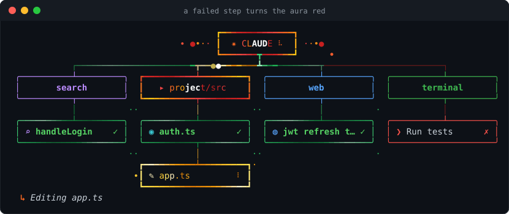
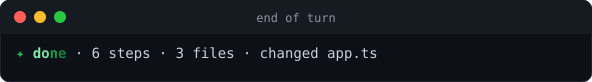

<div align="center">

# ✦ live-work

**See what Claude is working on, live, with an animated tree above the prompt.**

A mod for the [Claude Code](https://claude.com/claude-code) CLI. Every file, command, search and web lookup becomes a box, pulses run along the lines while the work happens, and aura colours follow what Claude is doing.

[](LICENSE)




</div>

## Install

At the prompt of a Claude Code terminal session:

```
/plugin install live-work --marketplace Brawly0/claude-cli-better-thinking-mod
```

Answer `y` to add the marketplace, then press Enter to pick a scope (user scope turns it on in every session). That's it: the next time Claude uses a tool, the tree appears above your prompt.

<details>
<summary>Other ways to install</summary>

From a shell:

```
claude plugin install live-work --marketplace Brawly0/claude-cli-better-thinking-mod
```

In the desktop app: click **+** next to the prompt box, then **Plugins**, **Add marketplace** with `Brawly0/claude-cli-better-thinking-mod`, then **Add plugin**.

From a local clone, for development:

```
git clone https://github.com/Brawly0/claude-cli-better-thinking-mod
claude --plugin-dir ./claude-cli-better-thinking-mod
```

</details>

## What you see

| | |
|---|---|
| **CLAUDE box** | The root of the tree. Shows how many steps are running and done, how many files changed, and the active aura. |
| **Branches** | One box per place Claude is working: a folder, the terminal, search, the web, a connector or a helper agent. |
| **Leaves** | Each file Claude reads (◉) or edits (✎), each command (❯), search (⌕) and web lookup (◍). Up to 3 per branch, then `+N more`. Boxes stay for the whole turn. |
| **Activity line** | The step happening right now, e.g. `↳ Editing app.ts ▌`. |

### Animations

- **Comet pulses:** a dot with a 5-cell gradient tail runs from CLAUDE down to the box being worked on. When the step finishes, a green one runs home.
- **Aura borders:** gradients chase around the borders of live boxes.
- **Wings:** dots breathe out from both sides of the CLAUDE box, with stars twinkling at its corners.
- **Embers:** sparks rise up the sides of live boxes.
- **Done burst:** sparkles pop at a box's corners when its step finishes, then it settles to ✓.
- Labels shimmer, spinners turn, and new names type themselves in.

## Aura colours

<div align="center">

</div>

By default the aura is **mood**: it follows the work.

| Claude is… | Aura |
|---|---|
| reading files | 🌊 ocean |
| editing files | ✨ gold |
| running commands | 🟢 matrix |
| searching | 💜 violet |
| on the web | ❄️ ice |
| using a connector or tool | 🌅 sunset |
| hitting an error | 🔥 fire (for a moment) |

Pick a fixed aura with the `/aura` command. Your choice is remembered across sessions.

```
/aura sunset      # violet · ocean · sunset · matrix · gold · ice · fire · rainbow
/aura mood        # back to the default
/aura             # show the current aura
```

## When things go wrong, or right

A failed step shows a red ✗, and the mood aura flashes fire red:

<div align="center">

</div>

When the turn ends, the tree folds into one line:

<div align="center">

</div>

## Requirements

- **Claude Code CLI** with mod (hooks module) support. Run `claude update` if `/plugin install` doesn't know the command.
- A **truecolor terminal** for the gradients: Windows Terminal, iTerm2, WezTerm, Kitty, GNOME Terminal or VS Code's terminal. Older terminals still work but show flatter colours.
- A window about **80+ columns** wide. On narrow windows, branches that don't fit fold into a `N folded` count.

## Uninstall

```
/plugin uninstall live-work
```

Or turn it off without removing it: `/plugin`, then select **live-work** and disable it.

## How it works

The mod is a single hooks module ([`hooks/register.tsx`](hooks/register.tsx)):

- `tool.call` records each call as a leaf (file, command, search, web or connector) and marks it live until the result comes back.
- `ui.render` on the `AbovePrompt` slot draws the tree into a character grid, then colours each cell: box borders, wires, pulses, embers and labels.
- A 110 ms clock moves the animation while there's work to show, and rests when nothing is happening.
- `/aura` is a slash command registered by the mod. The choice is saved in the mod's own store.

It only reads tool names and their file paths, commands and queries in order to label boxes. It never changes, blocks or delays a tool call or a prompt, and sends nothing anywhere.

<details>
<summary>About the screenshots</summary>

The images in this README are drawn from the mod's real output: [`scripts/capture.test.tsx`](scripts/capture.test.tsx) runs the mod in Claude Code's plugin test harness and records each frame, and [`scripts/make-screenshots.js`](scripts/make-screenshots.js) turns those frames into the SVGs in [`assets/`](assets). To regenerate them, copy the capture test into `hooks/`, run `claude plugin test . > cap.out`, then `node scripts/make-screenshots.js cap.out assets`.

</details>

## License

[MIT](LICENSE) © 2026 Brawly0
